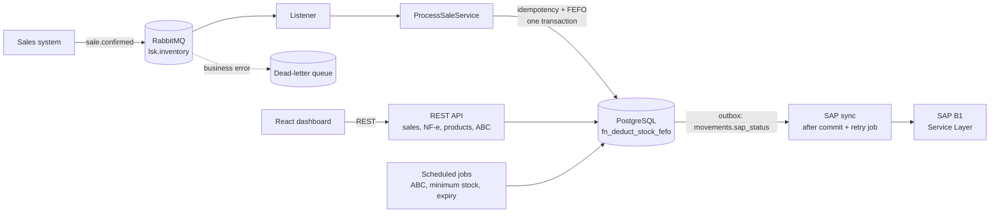

<h1 align="center">LSK Inventory</h1>

<p align="center">
  Inventory management backend with FEFO picking, ABC analysis, minimum-stock alerts<br>
  and an event-driven integration with SAP Business One.
</p>

<p align="center">
  
  
  
  
  
  
  
</p>

---

## Table of contents

- [Why this project](#why-this-project)
- [Features](#features)
- [Architecture](#architecture)
- [Tech stack](#tech-stack)
- [Quick start](#quick-start)
- [Dashboard](#dashboard)
- [API](#api)
- [Sales flow (event-driven)](#sales-flow-event-driven)
- [SAP Business One integration](#sap-business-one-integration)
- [Design decisions](#design-decisions)
- [Tests](#tests)
- [Project structure](#project-structure)
- [Status and limitations](#status-and-limitations)
- [Roadmap](#roadmap)
- [How this was built](#how-this-was-built)
- [Author](#author)
- [Disclaimer](#disclaimer)

## Why this project

Inventory systems look simple until you meet the real constraints: perishable goods must leave in expiry order,
sales events arrive from a broker and may be delivered more than once, the ERP can be down for hours, and two
orders can compete for the last unit at the same time.

LSK Inventory is my attempt at solving those problems properly, in a stack that mirrors what an SAP-centric company
uses: a service that owns the physical stock, receives sales as messages, and keeps SAP Business One in sync
**without ever blocking or rolling back a stock movement because the ERP is unavailable**.

## Features

- **FEFO picking** (First-Expired, First-Out) with FIFO fallback for items without an expiry date. Expired and blocked batches are never picked.
- **Idempotent sales processing**: the same `eventId` never deducts stock twice, even under redelivery.
- **Goods receipt from NF-e** (Brazilian electronic invoice) through JSON, idempotent by access key, with weighted average cost.
- **ABC analysis** by revenue over a 90-day window (A up to 80 %, B up to 95 %, C otherwise), recalculated nightly or on demand.
- **Minimum-stock alerts** that open when the balance reaches the threshold and close automatically when it recovers.
- **SAP B1 sync through an outbox**: asynchronous delivery after commit and automatic retries (up to 5 attempts).
- **Dead-letter queue** for business errors (unknown SKU, insufficient stock) and malformed payloads.
- **Operations dashboard** (React): register sales and goods receipts, manage products, watch alerts and retry failed SAP documents.
- **Swagger UI**, health checks, CI on every push and a one-command Docker setup.

## Architecture



The code follows a layered, ports-and-adapters style: the domain does not know about Spring Web, RabbitMQ or SAP.

## Tech stack

| Area | Technology |
|---|---|
| Language / framework | Java 17, Spring Boot 3.5 (Web, Data JPA, Validation, AMQP, Actuator) |
| Database | PostgreSQL 16, Flyway migrations, PL/pgSQL function for the picking rule |
| Messaging | RabbitMQ 3.13 (retry with backoff, dead-letter queue) |
| ERP | SAP Business One Service Layer (REST) |
| Front end | React 18, Vite, Recharts, served by nginx |
| Tests | JUnit 5, AssertJ, Testcontainers |
| Delivery | Docker multi-stage build, Docker Compose with health checks |
| CI | GitHub Actions (backend tests and dashboard build) |
| Docs | springdoc-openapi (Swagger UI), Postman/Insomnia collection |

## Quick start

Requires Docker Desktop. The whole stack (application, dashboard, PostgreSQL and RabbitMQ) starts with one command:

```bash
docker compose up -d --build
docker compose ps                        # wait until the application is "healthy"
curl http://localhost:8080/actuator/health
```

Load the sample data (`TONER-HP-85A` with two batches, `CABLE-UTP-CAT6`):

```bash
docker compose exec -T postgres psql -U lsk -d lsk_inventory < src/main/resources/db/dev/dev-seed.sql
```

For a richer demo (10 products, batches with different expiry dates, sales, ABC classes and alerts), run the demo script. It goes through the public API, so the data is created by the real flows:

```powershell
powershell -ExecutionPolicy Bypass -File docs/demo-data.ps1
```

| Service | URL |
|---|---|
| Dashboard | http://localhost:5173 |
| API | http://localhost:8080 |
| Swagger UI | http://localhost:8080/swagger-ui.html |
| RabbitMQ management | http://localhost:15672 (guest / guest) |
| PostgreSQL | localhost:5432 (lsk / lsk, database `lsk_inventory`) |

Reset everything with `docker compose down -v`.

To work on the dashboard with hot reload, stop its container first (both use port 5173):

```bash
docker compose stop dashboard
cd dashboard && npm install && npm run dev
```

To run the application outside Docker (for debugging):

```bash
docker compose up -d postgres rabbitmq
mvn spring-boot:run
```

## Dashboard

A React dashboard (Vite + Recharts) sits on top of the API. It is not a mock: every screen reads and writes real data,
and it refreshes itself every 10 to 15 seconds.

| | |
|---|---|
|  |  |
|  |  |

- **Overview**: indicators, ABC analysis chart with an on-demand recalculation, open minimum-stock alerts and the SAP integration state.
- **Products**: search, stock level against the minimum, and a side panel with the batches in picking order (FEFO). Create, edit and remove products; removal is a soft delete and is refused while there is stock.
- **New sale**: runs the same pipeline as the RabbitMQ listener and shows which batches were used. The form sends an idempotency key, so a double click never sells twice.
- **Receive goods (NF-e)**: multi-item receipts with batch and expiry. Submitting the same access key again returns a conflict.
- **Movements**: filters by type and SAP status, and a **Retry SAP** button for documents that failed.

## API

```bash
# Real-time position: balance and batches in the order they will be picked
curl http://localhost:8080/api/v1/stock/TONER-HP-85A

# Goods receipt from NF-e (idempotent by access key; resubmission returns 409)
curl -X POST http://localhost:8080/api/v1/stock/receipts/nfe -H 'Content-Type: application/json' -d '{
  "accessKey": "35260112345678000190550010000012341000012345",
  "number": "1234",
  "items": [{ "sku": "TONER-HP-85A", "batchCode": "L-2026-C", "quantity": 20,
              "unitCost": 119.50, "manufacturingDate": "2026-09-01", "expiryDate": "2027-09-01" }]
}'

# Products by ABC class
curl 'http://localhost:8080/api/v1/abc-analysis/products?abcClass=A'

# Recalculate the ABC analysis on demand (a nightly job also does it)
curl -X POST http://localhost:8080/api/v1/stock/abc-analysis/recalculate
```

Example response of the stock query. Note `pickingOrder`: the batch with the earliest expiry leaves first.

```json
{
  "sku": "TONER-HP-85A",
  "abcClass": "A",
  "availableBalance": 24.000,
  "minimumStock": 5.000,
  "belowMinimum": false,
  "batchesInPickingOrder": [
    { "batchCode": "L-2026-C", "expiryDate": "2027-09-01", "quantity": 4.000,  "criterion": "FEFO", "pickingOrder": 1 },
    { "batchCode": "L-2026-D", "expiryDate": "2027-09-01", "quantity": 20.000, "criterion": "FEFO", "pickingOrder": 2 }
  ]
}
```

A ready-to-import Postman/Insomnia collection is in [`docs/LSK-Inventory.postman_collection.json`](docs/LSK-Inventory.postman_collection.json).

### Endpoints used by the dashboard

| Method | Path | Purpose |
|---|---|---|
| `GET` | `/api/v1/products` | Active products with balance, ABC class and minimum-stock flag |
| `POST` | `/api/v1/products` | Create a product (reactivates a removed SKU) |
| `PUT` | `/api/v1/products/{sku}` | Update description, unit, minimum stock and price; re-evaluates the alert |
| `DELETE` | `/api/v1/products/{sku}` | Soft delete; refused while the product has stock |
| `POST` | `/api/v1/sales` | Register a sale (FEFO, idempotent through `idempotencyKey`) |
| `GET` | `/api/v1/alerts` | Open minimum-stock alerts |
| `GET` | `/api/v1/movements?limit=50` | Recent movements with their SAP status |
| `POST` | `/api/v1/movements/{id}/sap-retry` | Reset the retry counter and send the document now |
| `GET` | `/api/v1/categories` | Category names |
| `GET` | `/api/v1/system/status` | Whether the SAP integration is enabled |

## Sales flow (event-driven)

Sales arrive through RabbitMQ: exchange `lsk.inventory`, routing key `sale.confirmed`, `content_type = application/json`.

```json
{
  "eventId": "7b0c7a62-5d6a-4b0e-9a55-2f1d1d3f6a10",
  "order": "PED-1001",
  "occurredAt": "2026-10-08T14:30:00Z",
  "items": [{ "sku": "TONER-HP-85A", "quantity": 7, "unitPrice": 189.90 }]
}
```

You can publish it from the RabbitMQ management UI (Exchanges, `lsk.inventory`, Publish message).

What happens next, in a single database transaction: the `eventId` is registered in `processed_events`
(a duplicate stops here), each SKU is deducted by the FEFO function, movements are recorded in the outbox and minimum-stock
rules are evaluated. Only after the commit does the SAP synchronization start.

- Publishing the same `eventId` twice deducts the stock **once**.
- Unknown SKU or insufficient stock: the message goes to `lsk.inventory.sales.dlq` and the balance does not change.

## SAP Business One integration

Disabled by default (`lsk.sap.enabled=false`); movements simply wait as `PENDING` in the outbox. To enable it against a Service Layer:

```bash
SAP_ENABLED=true SAP_URL=https://server:50000 SAP_COMPANY_DB=SBO_LSK SAP_USER=... SAP_PASSWORD=... \
SAP_WAREHOUSE=01 mvn spring-boot:run
```

- Goods issue is posted to `InventoryGenExits` and goods receipt to `InventoryGenEntries`.
- Batches are sent in `BatchNumbers` (`lsk.sap.send-batches=false` for items without batch management).
- `ItemCode` comes from `products.sap_item_code`, falling back to the SKU.
- SAP-side idempotency: each document carries `Reference2 = SALE-<eventId>` / `NFE-<accessKey>`, and the service checks for it before creating.
- Self-signed certificates in DEV: `SAP_INSECURE_SSL=true` (or import the certificate into the JVM truststore).

### Developing without an SAP system

I do not have access to a real Business One instance, so the repository includes `mock-sap.js`, a small Node.js
mock of the Service Layer (login, goods issue and goods receipt) on port 50000.

```bash
node mock-sap.js                  # normal mode
MOCK_FAIL=1 node mock-sap.js      # every document request fails with HTTP 500
```

```powershell
# application on the host
$env:SAP_ENABLED="true"; $env:SAP_URL="http://localhost:50000"; $env:SAP_COMPANY_DB="MOCK"
$env:SAP_USER="mock"; $env:SAP_PASSWORD="mock"; mvn spring-boot:run

# application in Docker (reaches the host through host.docker.internal)
$env:APP_SAP_ENABLED="true"; docker compose up -d
```

Inspect the outbox:

```bash
docker compose exec -T postgres psql -U lsk -d lsk_inventory -c \
  "select type, reference, sap_status, sap_attempts, sap_doc_entry, sap_error from movements order by id"
```

**Failure and recovery scenario I validated:** with `MOCK_FAIL=1` the rows become `ERROR` and `sap_attempts` grows every minute;
after restarting the mock without the flag, the retry job moves them to `SENT` with the document number filled in.

## Design decisions

| Topic | Decision and reasoning |
|---|---|
| FEFO | The rule lives in one place, the PL/pgSQL function `fn_deduct_stock_fefo`, which locks product and batches, deducts and records movements atomically. Order: batches with expiry (earliest first, ties by receipt date), then batches without expiry (FIFO). It is a *function*, not a *procedure*, because the application needs the picked batches back as a result set. |
| Idempotency | `INSERT ... ON CONFLICT DO NOTHING` into `processed_events` inside the **same transaction** as the deduction, so a crash can never leave "processed but not deducted" (or the reverse). |
| SAP outbox | The movement and its `sap_status` are written together; delivery happens after commit and a job retries `PENDING`/`ERROR` rows. The ERP being down never undoes a physical stock movement. |
| Concurrency | `FOR UPDATE` on product and batches; SKUs of an order are processed in alphabetical order to avoid deadlocks between concurrent orders. |
| ABC analysis | Revenue (price times quantity of `SALE` outbound movements) over 90 days, turnover as tiebreaker. A product is class A while the cumulative share *before* it is under 80 %. Items without sales drop to C. |
| Minimum stock | Evaluated on every receipt and deduction and by a sweep every 15 minutes. One open alert per product, resolved automatically on recovery; also published to `lsk.inventory.alerts.q`. |
| Schema | Owned by Flyway; Hibernate runs with `ddl-auto=validate`, so any drift between entities and schema fails at startup instead of in production. |
| SAP documents | Goods issue and receipt map to `InventoryGenExits` and `InventoryGenEntries` in the Service Layer. |

## Tests

```bash
mvn test        # 26 integration tests on a real PostgreSQL via Testcontainers (requires Docker)
```

| Test class | Covers |
|---|---|
| `FefoDeductionIntegrationTest` | FEFO order, FIFO fallback, expired and blocked batches, insufficient stock |
| `NfeReceiptIntegrationTest` | Batch creation, idempotency by access key, weighted average cost, validations |
| `SaleIntegrationTest` | Event idempotency, business errors, minimum-stock alert lifecycle |
| `AbcAnalysisIntegrationTest` | A/B/C classification and downgrade of items without sales |
| `OperationsIntegrationTest` | Product creation, duplicated SKU, alert re-evaluation on minimum change, soft delete and reactivation |

The tests run against a real database on purpose: the picking rule is SQL, so mocking the repository would test nothing.

## Project structure

```
domain/          JPA entities, enums, exceptions and repository ports
application/     use-case services, DTOs, events, ErpGateway port
infrastructure/  adapters: JDBC (PL/pgSQL function), SAP B1, RabbitMQ, scheduled jobs
web/             REST controller and error handling (RFC 9457 problem details)
```

```
dashboard/       React dashboard (Vite) with its own Dockerfile
docs/            Postman/Insomnia collection and screenshots
.github/         CI workflow
mock-sap.js      SAP Service Layer mock for local development
Dockerfile       multi-stage build (Maven, then a slim JRE image)
docker-compose.yml   application + dashboard + PostgreSQL + RabbitMQ with health checks
```

## Status and limitations

- The SAP integration was validated end to end **against the mock**, including failure and retry, but not against a real Business One system. Field names and behavior follow the Service Layer documentation; a real environment may need adjustments (UoM, warehouses, user-defined fields).
- Authentication and authorization are not implemented in the API or in the dashboard; they are meant to run behind a gateway or on a private network.
- Credentials in `docker-compose.yml` are development defaults.

## Roadmap

- [x] Web dashboard (React): stock by batch, alerts, ABC chart, operations and SAP sync status
- [x] Code, database schema and API fully in English
- [ ] Authentication (OAuth2/JWT) and role-based access
- [x] CI pipeline (build and tests on every push)
- [ ] Metrics and tracing (Micrometer, OpenTelemetry)

## How this was built

I used an AI assistant (Claude) as a support tool during development: for code suggestions, for reviewing the database
design and the PL/pgSQL function, and for troubleshooting my environment. The design decisions are mine
(see [Design decisions](#design-decisions)), and so is the validation: I set up the environment (Docker, WSL2, Maven),
ran every scenario myself, and found and fixed real issues along the way (a `char(1)` versus `varchar` mapping bug,
Docker DNS problems during the image build, a transaction left in an aborted state inside a test).
Everything described in this README was executed and checked on my machine.

## Author

**Brayan**, backend developer focused on integrations and ERP-adjacent systems.

- GitHub: [@brayan-006](https://github.com/brayan-006)
- LinkedIn: [Brayan Latosinski](https://www.linkedin.com/in/brayanlatosinski)
- Company site: [LSK Technologies](https://brayan-006.github.io/lsk-technologies/)

## Disclaimer

This is an independent personal project. It is not affiliated with, sponsored by or endorsed by SAP SE.
SAP and SAP Business One are trademarks or registered trademarks of SAP SE; they are mentioned here only to describe
interoperability with the product's public REST API (Service Layer).

This repository contains no SAP software, binaries, proprietary code or confidential documentation, and it does not
connect to any SAP system by default. `mock-sap.js` is my own independent implementation of the few endpoints the
integration uses, written for local development and tests only.
